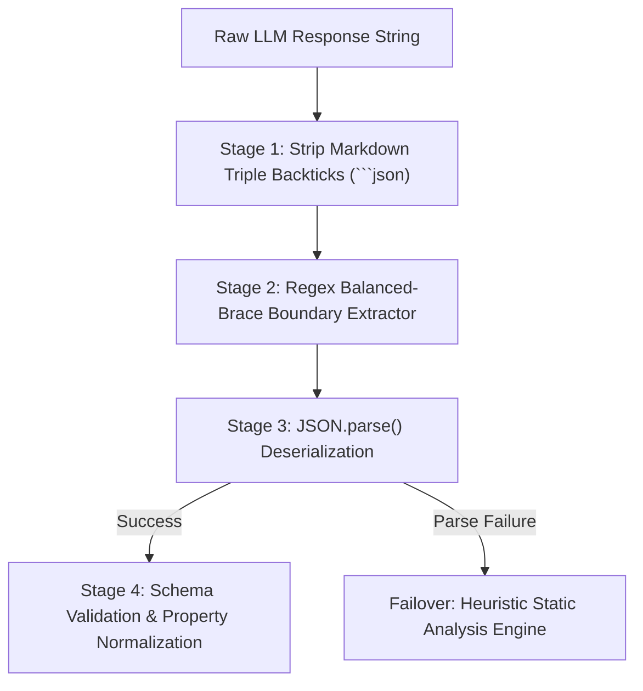

# 🧠 AI Usage & Prompt Engineering Strategy

> **Production Guide to LLM Orchestration, Prompt Engineering, Structured JSON Enforcement, and Offline Heuristic Resilience.**

---

## 1. Overview & Architectural Philosophy

In enterprise software engineering, code review assistants cannot rely on unpredictable, open-ended conversational output. They must satisfy three non-negotiable production requirements:
1. **Deterministic Structured Data**: Outputs must adhere strictly to typed JSON schemas to allow programmatic rendering (line-by-line diff viewers, severity badges, and automated ticket generation).
2. **Context Grounding (RAG-like Alignment)**: LLMs must be strictly anchored to the user's uploaded repository files, eliminating hallucinations and ensuring explicit file path citations.
3. **100% Operational Resilience**: If an external LLM provider encounters rate limits (HTTP 429), token exhaustion, or outages, the platform must seamlessly fall back to an offline static analysis engine with zero developer downtime.

---

## 2. Prompt Engineering Specification

All prompts are maintained in `backend/src/reviews/prompts.ts` and `backend/src/chat/chat.service.ts`. They use structured markdown framing, explicit role directives, and strict schema boundaries.

### 2.1 Security Audit Prompt (`SECURITY` Mode)
- **Persona**: Senior Application Security Engineer & OWASP Top 10 Specialist.
- **Focus Areas**: SQL/NoSQL injection, Cross-Site Scripting (XSS), hardcoded secrets/keys, broken access control, insecure dependencies, and unvalidated redirects.

```text
You are an expert Application Security Engineer specializing in the OWASP Top 10, CWE standards, and secure coding practices.

Analyze the following source code files for security vulnerabilities:
[PROJECT CODE FILES CONTEXT]

CRITICAL RULES:
1. Every reported issue MUST cite the exact relative file path and precise line numbers.
2. Provide a concrete, copy-pasteable remediation code snippet in "suggestion".
3. Return ONLY a valid JSON object matching the schema below. No markdown backticks outside the JSON.

SCHEMA:
{
  "summaryScore": <number 0-100 security rating>,
  "summaryText": "<executive summary of security posture>",
  "issues": [
    {
      "severity": "CRITICAL" | "HIGH" | "MEDIUM" | "LOW" | "INFO",
      "category": "<e.g., SQL Injection, Hardcoded Secret, Insecure CORS>",
      "title": "<concise title>",
      "description": "<detailed vulnerability explanation and exploit impact>",
      "filePath": "<relative/file/path.ext>",
      "lineStart": <number>,
      "lineEnd": <number>,
      "suggestion": "<remediated code snippet>",
      "codeSnippet": "<vulnerable code excerpt>"
    }
  ]
}
```

---

### 2.2 Performance Audit Prompt (`PERFORMANCE` Mode)
- **Persona**: Principal Systems Architect & Performance Optimization Lead.
- **Focus Areas**: Algorithmic complexity ($O(n^2)$ or worse), synchronous event loop blocking, memory leaks, unclosed database connection pools, unindexed queries, and excessive DOM re-renders.

```text
You are a Principal Software Architect specializing in runtime performance, memory optimization, and algorithmic efficiency.

Analyze the following source code files for performance bottlenecks:
[PROJECT CODE FILES CONTEXT]

EVALUATION CRITERIA:
- Identify blocking synchronous I/O operations (e.g. fs.readFileSync in server handlers).
- Detect unmemoized heavy calculations or redundant state re-renders.
- Flag missing database pagination and N+1 query patterns.

SCHEMA:
{
  "summaryScore": <number 0-100 performance rating>,
  "summaryText": "<summary of performance findings>",
  "issues": [
    {
      "severity": "CRITICAL" | "HIGH" | "MEDIUM" | "LOW" | "INFO",
      "category": "<e.g., Event Loop Blocking, Memory Leak, N+1 Query>",
      "title": "<issue title>",
      "description": "<technical explanation of bottleneck>",
      "filePath": "<relative/path.ext>",
      "lineStart": <number>,
      "lineEnd": <number>,
      "suggestion": "<optimized replacement code>",
      "codeSnippet": "<inefficient code excerpt>"
    }
  ]
}
```

---

### 2.3 Quality & Architecture Prompt (`QUALITY` Mode)
- **Persona**: Staff Software Craftsman & Clean Code Advocate.
- **Focus Areas**: SOLID design principles, DRY violations, circular dependencies, dead code, swallowed exceptions, and type safety regressions (`any` types).

```text
You are a Staff Software Engineer evaluating architectural integrity, maintainability, and clean code principles.

Analyze the provided source code files:
[PROJECT CODE FILES CONTEXT]

EVALUATION CRITERIA:
- Adherence to SOLID principles and separation of concerns.
- Type safety and eradication of loose "any" types in TypeScript/typed languages.
- Proper exception handling and prevention of swallowed errors (empty catch blocks).

SCHEMA:
{
  "summaryScore": <number 0-100 quality rating>,
  "summaryText": "<overview of code maintainability>",
  "issues": [ ... ]
}
```

---

### 2.4 Automated Documentation Generation Prompt
- **Endpoint**: `POST /api/reviews/generate-docs`
- **Output**: Production-grade JSDoc / TSDoc annotations and a comprehensive architectural Markdown README for the target file or project.

```text
You are a Lead Technical Writer and Software Architect.
Generate professional, comprehensive documentation for the following code:

[FILE CONTENT]

Requirements:
1. Provide standard JSDoc / docstring annotations for all exported classes, functions, and interfaces.
2. Include parameter types, return descriptions, and documented exception states.
3. Append a clean Markdown module overview explaining the component's architecture and usage examples.
```

---

### 2.5 Automated Unit Test Generation Prompt
- **Endpoint**: `POST /api/reviews/generate-tests`
- **Output**: Runnable unit test suites adhering to the **Arrange-Act-Assert (AAA)** pattern using standard frameworks (Jest for TS/JS, PyTest for Python, Go test for Go).

```text
You are a Senior QA Automation Engineer.
Generate a complete, executable unit test suite for the following component:

[FILE CONTENT]

Requirements:
1. Use the standard test framework for the file's language (e.g. Jest / Vitest for TypeScript).
2. Cover the happy path, boundary edge cases, null/undefined inputs, and error-handling branches.
3. Include all necessary mock setups and assertion assertions.
```

---

### 2.6 Interactive Codebase Chat System Prompt
- **Endpoint**: `POST /api/chat/sessions/:sessionId/messages`
- **Context Grounding**: The backend embeds the project's file hierarchy and content directly into the conversation's `system` message.

```text
You are an expert AI software architect and coding assistant. You have full access to the codebase files for the project "[PROJECT NAME]".
Answer questions about how the code works, explain authentication/database logic, locate APIs, and assist with debugging.

CRITICAL RULE:
- Always explicitly cite the relative file path(s) (e.g. `src/auth/jwt.strategy.ts`) when explaining code architecture or answering location questions.

Project Source Code Context:
--- src/auth/auth.service.ts ---
[CONTENT]

--- src/database/database.service.ts ---
[CONTENT]
```

---

## 3. Structured Output & Resilience Pipeline

LLMs are fundamentally probabilistic text generators. In production, LLMs frequently wrap JSON in markdown blocks (` ```json ... ``` `) or include introductory conversational preambles (e.g., *"Sure, here are the issues found:"*). 

To ensure 100% parsing reliability, the system implements a **multi-stage extraction pipeline**:



### Implementation (`backend/src/reviews/reviews.service.ts`):
```typescript
private cleanJsonResponse(raw: string): string {
  let cleaned = raw.trim();

  // 1. Strip leading and trailing markdown code block wrappers
  if (cleaned.startsWith('```json')) {
    cleaned = cleaned.replace(/^```json\s*/, '').replace(/\s*```$/, '');
  } else if (cleaned.startsWith('```')) {
    cleaned = cleaned.replace(/^```\s*/, '').replace(/\s*```$/, '');
  }

  // 2. Extract balanced JSON object boundaries
  const firstBrace = cleaned.indexOf('{');
  const lastBrace = cleaned.lastIndexOf('}');
  if (firstBrace !== -1 && lastBrace !== -1 && lastBrace > firstBrace) {
    return cleaned.substring(firstBrace, lastBrace + 1);
  }

  return cleaned;
}
```

---

## 4. Multi-Provider Strategy & Bring-Your-Own-Model (BYOM)

The application implements a unified adapter layer supporting both cloud and local inference targets:

| Provider | Supported Models | Connection Type | Typical Use Case |
|---|---|---|---|
| **OpenAI** | `gpt-4o`, `gpt-4o-mini`, `o1-mini` | Cloud HTTPS (`api.openai.com/v1`) | High-accuracy enterprise production reviews. |
| **OpenRouter** | `anthropic/claude-3.5-sonnet`, `deepseek/deepseek-r1`, `meta-llama/llama-3.2-3b-instruct:free` | Cloud HTTPS Gateway (`openrouter.ai/api/v1`) | Free experimentation or multi-vendor model comparison. |
| **LM Studio** | Any GGUF model (`qwen2.5-coder-7b`, `deepseek-coder`) | Localhost HTTP (`localhost:1234/v1`) | Air-gapped, zero-cost, privacy-compliant developer environments. |
| **Ollama** | `codellama`, `qwen2.5-coder`, `mistral` | Localhost HTTP (`localhost:11434/v1`) | Native CLI-driven local inference on developer laptops. |

---

## 5. Built-in Static Analysis Fallback Engine

When external LLMs cannot be reached (e.g., HTTP 429 quota exhaustion, invalid API credentials, or offline environments), the backend's **Static Analysis Heuristic Engine** activates automatically.

### Heuristic Rule Categories:
1. **Security Vulnerability Heuristics**:
   - Hardcoded Secrets & API Keys: `/(api[_-]?key|secret[_-]?key|password|jwt[_-]?secret)\s*[:=]\s*["'][^"']{6,}["']/i`
   - Unsafe Dynamic Code Execution: `/\beval\s*\(/`
   - Insecure In-Transit Protocols: `http://` URLs (excluding localhost)
2. **Performance Bottleneck Heuristics**:
   - Synchronous I/O in Handlers: `readFileSync`, `writeFileSync`, `execSync`
   - Unbounded Loops: Nested loops matching potential $O(n^2)$ complexity
3. **Quality & Maintainability Heuristics**:
   - Swallowed Exceptions: `catch\s*(\([a-zA-Z0-9_]*\))?\s*\{\s*\}` (empty catch blocks)
   - Loose Typing: `:\s*any\b` in TypeScript source files
   - Leftover Debugging Code: `console.log`, `debugger` statements

This guarantees that developers **always receive actionable audit feedback**, maintaining unbroken productivity even when third-party cloud APIs are unavailable.
