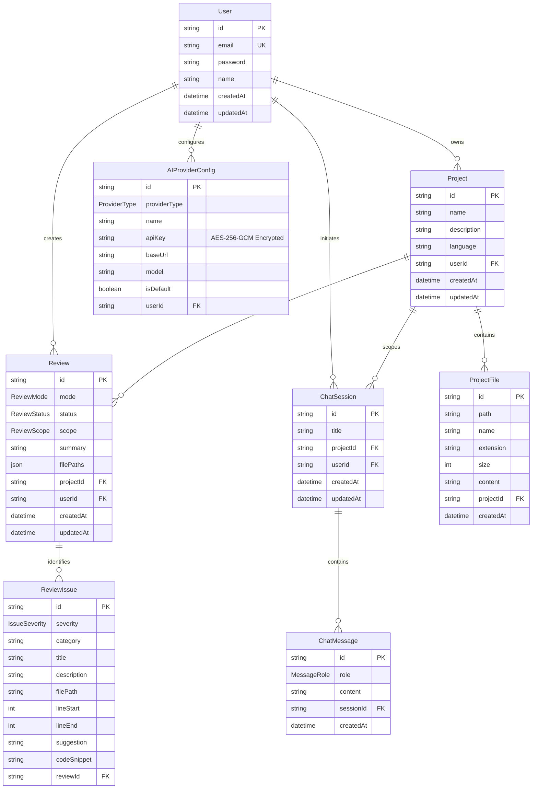
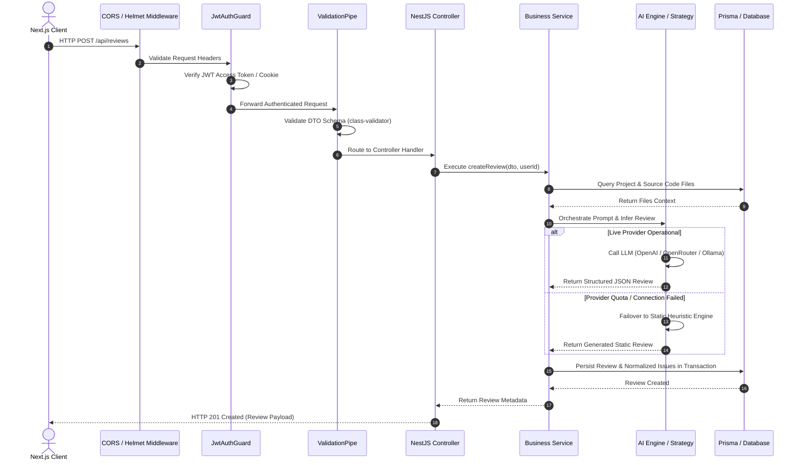

# 🏛️ Architecture Documentation: AI-Powered Code Review Assistant

This document outlines the software architecture, design patterns, security controls, and data structures implemented in the **AI-Powered Code Review Assistant**.

---

## 1. High-Level System Architecture

The application adopts a **Modular Monolithic Architecture** on the backend paired with a **Modern Jamstack / Server-Driven UI** on the frontend. This strikes an optimal balance between rapid iteration, operational simplicity, and strict domain boundary separation.

```mermaid
graph TD
    Client["🌐 Next.js 15 Client (App Router)"]
    
    subgraph Security Layer
        CORS["CORS & Helmet Middleware"]
        AuthGuard["JWT Guard (Passport-JWT)"]
        Validation["Class-Validator ValidationPipe"]
    end

    subgraph Backend Monolith (NestJS 11)
        AuthMod["Auth Module"]
        ProjMod["Projects Module"]
        FileMod["Files Module (AdmZip Engine)"]
        ReviewMod["Reviews Module (AI Engine)"]
        ChatMod["Chat Module (Context Grounding)"]
        AiMod["AI Provider Service (Factory / Strategy)"]
    end

    subgraph Persistence Layer (Prisma ORM)
        DB[("Database (SQLite Dev / PostgreSQL Prod)")]
    end

    subgraph Inference Layer
        OpenAI["Cloud: OpenAI (gpt-4o)"]
        OpenRouter["Cloud: OpenRouter Gateway"]
        LMStudio["Local: LM Studio (localhost:1234)"]
        Ollama["Local: Ollama (localhost:11434)"]
        StaticEngine["Offline: Heuristic Static Engine"]
    end

    Client -->|HTTP / REST + Cookies| CORS
    CORS --> AuthGuard
    AuthGuard --> Validation
    Validation --> AuthMod
    Validation --> ProjMod
    Validation --> FileMod
    Validation --> ReviewMod
    Validation --> ChatMod

    ReviewMod --> AiMod
    ChatMod --> AiMod
    
    AiMod -->|Primary| OpenAI
    AiMod -->|Alternative| OpenRouter
    AiMod -->|Local Inference| LMStudio
    AiMod -->|Local Inference| Ollama
    AiMod -.->|Failover / Fallback| StaticEngine

    AuthMod --> DB
    ProjMod --> DB
    FileMod --> DB
    ReviewMod --> DB
    ChatMod --> DB
```

---

## 2. Domain-Driven Modular Decomposition

The backend source (`backend/src/`) is decomposed into distinct, encapsulated feature modules following NestJS dependency injection patterns:

```
backend/src/
├── auth/           # Authentication, password hashing, JWT issue & refresh rotation
├── users/          # User entity persistence, profile management
├── projects/       # Project workspaces, ownership validation, repository metadata
├── files/          # Multipart ingestion, directory tree extraction, AdmZip parsing
├── reviews/        # Multi-mode review orchestration, issue classification, Doc & Test gen
├── chat/           # Conversational code assistant, session state, context budgeting
├── ai/             # Strategy-pattern AI Provider abstraction layer & AES key crypto
├── prisma/         # PrismaService singleton lifecycle management
└── common/         # Global guards, interceptors, decorators, and cryptographic utilities
```

### Module Responsibilities & Coupling:
- **`AuthModule`**: Implements Passport JWT strategy with dual-token architecture (short-lived access token + long-lived HTTP-only refresh token).
- **`FilesModule`**: Handles file buffer ingestion, folder structure preservation (`webkitRelativePath`), and sanitization against non-code or binary formats.
- **`ReviewsModule`**: Orchestrates automated code audits across **SECURITY**, **PERFORMANCE**, and **QUALITY** modes.
- **`AiModule`**: Decoupled factory that instantiates provider adapters based on user preference, completely isolating LLM vendor SDKs from domain business logic.

---

## 3. Entity-Relationship Data Model (ERD)

The database schema is managed declaratively via Prisma ORM, enforcing strict foreign key constraints and cascade-deletion semantics:



---

## 4. End-to-End Request-Response Pipeline

Every incoming HTTP request undergoes a standardized multi-stage filtering and validation sequence before executing service logic:



---

## 5. Security & Privacy Architecture

### 5.1 Multi-Tenant Isolation
All query operations in `ProjectsService`, `FilesService`, `ReviewsService`, and `ChatService` enforce explicit ownership filters (`where: { id: resourceId, userId }`). Cross-tenant horizontal privilege escalation (BOLA / IDOR) is structurally impossible.

### 5.2 Cryptographic Protection of AI Credentials
Users can configure proprietary API keys. These keys are never stored in plain text:
- **Cipher**: `AES-256-GCM` (Galois/Counter Mode).
- **Integrity**: Authenticated encryption produces an authentication tag alongside the ciphertext, preventing ciphertext tampering.
- **Key Derivation**: The system utilizes a dedicated 32-byte (64 hex character) master encryption key passed via environment variables.

### 5.3 Zip-Slip & Path Traversal Mitigation
When unpacking `.zip` archives or processing directory uploads:
1. File paths are normalized to POSIX style (`/`).
2. Leading slashes, relative parent directory markers (`../`), and absolute paths are stripped.
3. Hidden OS directories (`.git`, `node_modules`, `__MACOSX`, `.DS_Store`) are filtered out automatically.

---

## 6. AI Abstraction & Strategy Pattern

The `AiService` adheres to the **GoF Strategy Pattern** through `AIProviderInterface`:

```typescript
export interface AIProviderInterface {
  chatCompletion(params: ChatCompletionParams): Promise<string>;
  chatCompletionStream?(params: ChatCompletionParams): AsyncGenerator<string, void, unknown>;
}
```

```
               +-------------------------+
               |   AIProviderInterface   |
               +-------------------------+
                            ▲
        ┌───────────────────┼───────────────────┐
        │                   │                   │
+---------------+   +---------------+   +---------------+
| OpenAIProvider|   | LMStudioProvider| | OpenRouterProvider|
| (Cloud API)   |   | (Local HTTP)  |   | (Multi-Model) |
+---------------+   +---------------+   +---------------+
```

Because **LM Studio**, **Ollama**, and **OpenRouter** implement the standardized OpenAI REST completion specification (`/v1/chat/completions`), a single robust adapter covers both local and cloud inference nodes.

---

## 7. Resilience & Circuit-Breaking Strategy

To eliminate reliance on external cloud availability:
1. **Adaptive Failover**: If an external LLM call encounters HTTP 429 (quota exhaustion), network timeouts, or invalid credentials, the system immediately diverts execution to the **built-in static analysis engine**.
2. **Context Budgeting**: Projects containing large numbers of files are pruned to the most architecturally significant source code files (`take: 30`, max 3000 chars per file) to prevent LLM context-window truncation.
3. **Structured Heuristic Extraction**: All LLM JSON responses pass through regex sanitation filters (`cleanJsonResponse`), stripping extraneous backticks and conversational artifacts.

---

## 8. Scalability & Enterprise Roadmap

```
+--------------------------------------------------------------------------+
| PHASE 1 (Current): Modular Monolith + Synchronous Event Processing       |
| • Prisma ORM + Multi-Provider AI Hub + Heuristic Offline Fallback        |
+--------------------------------------------------------------------------+
                                     │
+--------------------------------------------------------------------------+
| PHASE 2 (Target): Distributed Job Queue & Asynchronous Processing       |
| • BullMQ + Redis for background review task workers                      |
| • Server-Sent Events (SSE) / WebSockets for live streaming reviews       |
+--------------------------------------------------------------------------+
                                     │
+--------------------------------------------------------------------------+
| PHASE 3 (Enterprise): Semantic Search & Vector Retrieval (RAG)           |
| • PostgreSQL pgvector embedding generation for 100,000+ line codebases   |
| • GitHub Actions / GitLab CI Webhook Automated PR Bots                   |
+--------------------------------------------------------------------------+
```
